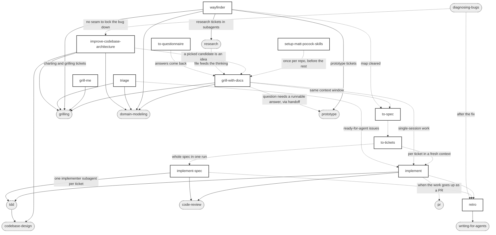

# Matt Pocock's skills: what each one is and how they hand work to each other

Research for [#102](https://github.com/BoLiDev/Yan/issues/102), a ticket on the map [#101](https://github.com/BoLiDev/Yan/issues/101). It describes the skills as they are; it does not say how Yan should tailor them.

## Sources

Everything here was read from the skill files themselves, not from write-ups of them.

- `mattpocock/skills` at commit [`bbadaa6`](https://github.com/mattpocock/skills/tree/bbadaa631c37af594e5a05c9cefacd9956136b18) (2026-11-27, plugin version 1.3.2). Every path cited below in `code` is relative to that tree, so `skills/engineering/wayfinder/SKILL.md` is <https://github.com/mattpocock/skills/blob/bbadaa631c37af594e5a05c9cefacd9956136b18/skills/engineering/wayfinder/SKILL.md>.
- The copies installed under `~/.claude/skills/` (wayfinder, grilling, domain-modeling, prototype, research, setup-matt-pocock-skills). A recursive diff against the tree above found all six identical, so one citation covers both.
- The repo's human-facing docs pages (`docs/engineering/*.md`, `docs/productivity/*.md`) are first-party but secondary to the `SKILL.md` files; where a claim rests only on a docs page it says so.

## The short answer

- The repo holds 39 skills in four buckets. 27 are promoted and ship in the plugin (20 engineering, 7 productivity); 8 are in-progress betas; 4 are frozen misc (`CLAUDE.md`, `.claude-plugin/plugin.json`). There is no skill called `spec`: the skill is `to-spec`, renamed from `to-prd` (`CHANGELOG.md`).
- One spine carries most work: **grill-with-docs → to-spec → to-tickets → implement (or implement-spec) → retro**. Two on-ramps and one planner merge onto it: `triage` and `diagnosing-bugs` generate work, and `wayfinder` plans an effort too big for one session and rejoins the spine at `to-spec` (`skills/engineering/ask-matt/SKILL.md`).
- A few small model-invoked skills hold the reusable discipline and are called by the rest: `grilling` (the interview), `domain-modeling` (glossary and ADRs), `prototype`, `research`, `tdd`, `code-review`, `codebase-design`.
- **A skill never hands to the next step of the spine. The human does.** User-invoked skills cannot call each other (`.agents/invocation.md`), and every step of the spine is user-invoked, so `to-spec` does not start `to-tickets`; the person types it, with `ask-matt` as the map of what to type next. Skills only call downward, into the model-invoked ones.
- The tracker is reached through one indirection: an `## Agent skills` block in `AGENTS.md`/`CLAUDE.md` pointing at `docs/agents/issue-tracker.md`, a prose file that says how to do each operation on this repo's tracker. GitHub, GitLab and local markdown have templates; anything else is a paragraph the user writes (`skills/engineering/setup-matt-pocock-skills/SKILL.md`).
- Goals, decisions and solutions each have one home, and everything else points at it rather than copying it. See [Where things are recorded](#where-a-goal-a-decision-and-a-solution-are-recorded).

## Two kinds of skill

The one axis the repo sorts skills on is who can invoke them (`.agents/invocation.md`, `README.md`):

- **User-invoked** (`disable-model-invocation: true`): reachable only by the human typing the name. "Their job is to orchestrate."
- **Model-invoked**: reachable by the model or the user. "They hold the reusable discipline."

"A user-invoked skill may invoke model-invoked skills, but never another user-invoked one." A dependency is written as an explicit instruction, `Call the Skill tool with "grilling"`, one skill per call. A precondition that is user-invoked (setup) is phrased as "tell the user to run `/setup-matt-pocock-skills`".

Reading `GLOSSARY.md` for vocabulary is a one-line habit any skill has; only actively changing the domain model is `domain-modeling` (`.agents/invocation.md`, "Passive vs active domain work").

## Hand-offs

Solid arrows are a skill calling another through the Skill tool (stated in the caller's `SKILL.md`). Dashed arrows are hand-offs the human makes by typing the next skill, as `ask-matt` routes them.

Square boxes are user-invoked, rounded are model-invoked. Sources: each caller's `SKILL.md` for the solid arrows; `skills/engineering/ask-matt/SKILL.md` for the dashed ones.

The same as a table, with what crosses each hand-off:

| From | To | What is handed over | Who makes the hand-off |
| --- | --- | --- | --- |
| grill-with-docs | to-spec | The conversation itself, kept in one unbroken context window; plus `GLOSSARY.md` and ADRs written on the way | Human (`ask-matt`, "Context hygiene") |
| wayfinder (map cleared) | to-spec | The map issue, whose Decisions-so-far links every closed decision ticket | Human; `/to-spec #<map_issue>` per the docs pages `docs/engineering/wayfinder.md` and `to-spec.md` |
| to-spec | to-tickets | The spec issue (label `ready-for-agent`) | Human; `to-tickets` takes "a spec path, an issue number or URL" |
| to-tickets | implement | One ticket, self-contained, fetched from the tracker; context cleared between tickets | Human |
| to-tickets | implement-spec | The spec and its tickets as a task graph | Human |
| implement / implement-spec | tdd, then code-review | The ticket and the pre-agreed seams; then the diff plus the originating spec | Skill tool |
| triage | implement | An issue labelled `ready-for-agent` carrying an agent brief comment | Human, or an AFK agent picking up the label |
| wayfinder | research | One research ticket's question, to a fresh-context subagent; findings land on a `research/<name>` branch with a pointer from the ticket | Skill tool, in a subagent |
| wayfinder | prototype | A prototype ticket's question; the prototype is linked from the ticket as an asset | Skill tool |
| wayfinder, grill-with-docs, triage, improve-codebase-architecture | grilling + domain-modeling | The plan or question; decisions come back from the user, terms and ADRs land in the repo | Skill tool, two calls |
| prototype | the real code and the issue | Validated decision folded into code; prototype on a throwaway branch; verdict in the issue or a commit | The skill's own last rule |
| diagnosing-bugs | retro / improve-codebase-architecture | The session (retro reads it); a missing seam as a finding | Human; the skill's own hand-off was removed (`CHANGELOG.md`) |
| any session | handoff | A markdown file in the OS temp directory naming suggested skills and pointing at existing artifacts | Human; only for a new harness, directory, colleague, or mid-phase side task (`ask-matt/PHASE-BOUNDARIES.md`) |

## Every skill

"Tracker" means whatever `docs/agents/issue-tracker.md` describes. "Domain docs" means `GLOSSARY.md` (or `GLOSSARY-MAP.md`) and `docs/adr/`. U = user-invoked, M = model-invoked.

### Engineering (`skills/engineering/`)

| Skill | | Purpose | Reads | Writes, and where | Hands to |
| --- | --- | --- | --- | --- | --- |
| setup-matt-pocock-skills | U | Once per repo, record where issues live, the triage label strings, and the domain-doc layout | Git remotes, `AGENTS.md`/`CLAUDE.md`, existing domain docs, `docs/agents/`, `.scratch/`, monorepo signals, whether `triage` is installed | An `## Agent skills` block in whichever of `CLAUDE.md`/`AGENTS.md` exists; `docs/agents/issue-tracker.md`, `domain.md`, and `triage-labels.md` (only if `triage` is installed); creates missing labels on GitHub/GitLab | Every engineering skill reads its output |
| ask-matt | U | Router: which skill or flow fits the situation | The other skills' `SKILL.md` before describing them | Nothing | Names the next skill for the human |
| grill-with-docs | U | Interview that sharpens an idea and leaves a paper trail. Its whole body is "Call the Skill tool twice, for grilling and domain-modeling" | via its two callees | via domain-modeling | to-spec, or implement for small work (human) |
| wayfinder | U | Plan an effort too big for one session as a map of decision tickets, resolving one per session | The tracker doc's "Wayfinding operations"; the map issue; ticket bodies on demand; skills the map's Notes name | A map issue labelled `wayfinder:map`; child issues labelled `wayfinder:<type>`; native blocking edges; an assignee as the claim; a resolution comment and close per ticket; a one-line gist and link appended to the map | grilling + domain-modeling, prototype, research (Skill tool); to-spec when the map clears (human) |
| to-spec | U | Synthesize the conversation into a spec, no interview | The conversation, the codebase, domain docs; confirms test seams with the user | One issue on the tracker (locally `.scratch/<feature>/spec.md`), label `ready-for-agent`, with Problem Statement, Solution, User Stories, Implementation Decisions, Testing Decisions, Out of Scope, Further Notes | to-tickets (human) |
| to-tickets | U | Break a spec, plan or conversation into tracer-bullet tickets with blocking edges; user approves the breakdown | The conversation or a referenced spec/issue with its comments; the codebase; domain docs | One issue per ticket, blockers first, as sub-issues of the source issue, native blocking edges, label `ready-for-agent` (locally `.scratch/<feature>/issues/<NN>-<slug>.md`). Never closes or edits the parent | implement or implement-spec (human) |
| implement | U | Build one spec or ticket | The ticket, fetched from the tracker; states its title | Code, committed to the current branch | tdd, then code-review (Skill tool) |
| implement-spec | U | Build a whole spec on one integration branch, parallel subagents over the ready frontier | The spec and its tickets as a task graph; optional exploration notes saved outside the repo | An integration branch; a worktree and branch per ticket, merged by a merger subagent; a draft PR if the tracker closes work through PRs; tickets resolved "the way the issue tracker closes work" | tdd per implementer, one code-review at the end (Skill tool) |
| triage | U | Move incoming issues (and optionally external PRs) through a state machine | The issue and its comments; the codebase; domain docs; `.out-of-scope/*.md`; the label mapping | Labels (one category, one state); an agent brief or triage notes as a comment, each starting with an AI disclaimer; `.out-of-scope/<concept>.md` for a rejected enhancement; closes `wontfix` | grilling + domain-modeling if needed (Skill tool); implement later (human or AFK agent) |
| improve-codebase-architecture | U | Survey for shallow modules, report candidates, grill the one picked | Commit history for hot spots; the codebase via a subagent; domain docs | An HTML report in the OS temp directory, nothing in the repo; glossary terms and ADRs via domain-modeling | codebase-design, grilling, domain-modeling (Skill tool); grill-with-docs (human) |
| retro | U | After a session, suggest changes to the agent's environment, most severe first | The session's logs; the repo's check commands; steering files | Nothing itself: it presents candidates (navigation pointers, checks, `CODING_STANDARDS.md` rules, steering-file edits) | writing-for-agents (Skill tool) |
| prototype | M | Throwaway code that answers one design question: a single HTML file for logic, or UI variants on one route | The prompt and surrounding code | Prototype next to the code it is for, clearly named; then a throwaway branch out of main, a pointer on the implementation issue, the verdict in the issue or a commit | Back to whoever asked the question |
| research | M | Background agent reads primary sources and leaves one cited Markdown file | Primary sources only | One Markdown file "where the repo already keeps such notes" | grill-with-docs (human); under wayfinder, a resolution on the research ticket |
| domain-modeling | M | Challenge terms, test them with scenarios and against the code, write the glossary and ADRs as they settle | `GLOSSARY.md`, the code, the conversation | `GLOSSARY.md` inline, created lazily; `docs/adr/NNNN-slug.md` only when a decision is hard to reverse, surprising, and a real trade-off | Returns to its caller |
| tdd | M | Red-green loop at seams agreed with the user first | Domain docs for test vocabulary | Tests and code | codebase-design when the interface shape is in question; refactoring is left to code-review |
| code-review | M | Review the diff since a fixed point on two separate axes, Standards and Spec, in parallel subagents | The diff; the originating spec via commit messages, a path, or `docs/`, `specs/`, `.scratch/`; `CODING_STANDARDS.md`, `CONTRIBUTING.md` | A report in the conversation, the two axes kept apart | Returns to its caller |
| codebase-design | M | Vocabulary for deep modules: module, interface, depth, seam, adapter, leverage, locality | Nothing: a reference | Nothing | Consulted by tdd and improve-codebase-architecture |
| diagnosing-bugs | M | Build a pass/fail loop that goes red on this bug, minimise, hypothesise, instrument, fix with a regression test | Domain docs; the code | A regression test and fix; the correct hypothesis in the commit or PR message | retro, improve-codebase-architecture (human) |
| pr | M | The shape of a PR body: a visual summary, before/after evidence, one-way or two-way door and blast radius | `GLOSSARY.md` for vocabulary | The PR body | None |
| wizard | M | Generate a bash script that walks a human through steps only they can take | `.env*`, README, CI workflows | A script in a scratch or `scripts/` path; when run, `.env` and GitHub secrets | The human runs it |

### Productivity (`skills/productivity/`)

| Skill | | Purpose | Reads | Writes, and where | Hands to |
| --- | --- | --- | --- | --- | --- |
| grilling | M | The interview primitive: a design tree worked in rounds, the whole frontier asked at once, each question with a recommended answer; facts are the agent's to find, decisions are the user's | The conversation; the environment through fresh-context subagents | Nothing | Stops until the user confirms a shared understanding |
| grill-me | U | The stateless interview, for work with no repo under it. Body: "Call the Skill tool with grilling" | via grilling | Nothing | None |
| handoff | U | Compact the conversation for another agent | The conversation | A markdown file in the OS temp directory, with a "suggested skills" section; references other artifacts instead of copying them | A fresh session |
| to-questionnaire | U | Turn a decision only someone else can answer into a questionnaire; grills the user about the send, not the subject | The user's answers about recipient and need | `to-questionnaire-<slug>.md` in the current directory | grill-with-docs or to-spec once answered (human) |
| wait-what | U | Re-pitch the last message in plain English with the glossary's vocabulary | `GLOSSARY.md` | Nothing | None |
| teach | U | Teach a topic over many sessions in a stateful workspace | The workspace files | `MISSION.md`, `RESOURCES.md`, `NOTES.md`, `lessons/*.html`, `reference/*.html`, `learning-records/NNNN-*.md`, `assets/` in the current directory | None |
| writing-for-agents | M | Reference for writing skills, `AGENTS.md`, and pointed-at docs: context pointers, context load versus cognitive load | Nothing: a reference | Nothing | Consulted by retro |

### In progress (`skills/in-progress/`, not in the plugin, "can change or disappear without warning")

| Skill | Purpose | Writes | Relation to the rest |
| --- | --- | --- | --- |
| chief-of-staff | Delegate each task to a fresh background subagent and remember what it taught in a dated wiki | A wiki folder (`index.md` plus one page per thing), every claim dated or pinned to a commit, superseded claims left as written | Runs retro, and to-spec → to-tickets → implement-spec, by reading their `SKILL.md` by relative path, which sidesteps the rule that user-invoked skills cannot call each other |
| loop-me | Stateful grilling whose only output is specs of recurring workflows | `workflows/*.md`, `NOTES.md` in the current directory | Uses the grilling discipline |
| claude-handoff | handoff, then launch a background agent seeded with the summary | A summary in the OS temp directory | Variant of handoff |
| software-factory | Vocabulary for designing a system of agents that turns tickets, PRs and schedules into merged code | Nothing | Used alongside grilling |
| setup-ts-deep-modules | Enforce deep modules in a TypeScript repo with dependency-cruiser | Config and rules in the repo | Uses codebase-design |
| writing-fragments, writing-beats, writing-shape | Mine fragments for an article by grilling, then shape them into an article | One markdown file each, at a path the user gives | Fragments feed beats or shape |

### Misc (`skills/misc/`, frozen)

`git-guardrails-claude-code` (hooks that block dangerous git commands), `migrate-to-shoehorn` (test type assertions), `scaffold-exercises` (course exercise folders), `setup-pre-commit` (Husky and lint-staged). None takes part in the flows above. `skills/deprecated/` is empty.

## What the skills assume about the issue tracker

**How it is reached.** No skill names a tracker command or a path. Each says "the issue tracker should have been provided to you", meaning the `## Agent skills` block in `AGENTS.md`/`CLAUDE.md` that points to `docs/agents/issue-tracker.md` (`setup-matt-pocock-skills/SKILL.md`; `CHANGELOG.md` records wayfinder being fixed to use the same pointer). The repo's own ADR splits skills into hard dependencies (`to-tickets`, `to-spec`, `triage`: "without the mapping, output is wrong") and soft ones that only sharpen their output with domain docs (`.agents/adr/0001-explicit-setup-pointer-only-for-hard-dependencies.md`). `wayfinder`, `implement-spec` and `code-review` now carry the same pointer line. With no tracker provided, wayfinder defaults to local markdown.

**What the tracker doc must answer.** From the three templates (`setup-matt-pocock-skills/issue-tracker-github.md`, `-gitlab.md`, `-local.md`), a tracker doc is prose that defines:

| Operation | GitHub template | Local-markdown template |
| --- | --- | --- |
| "Publish to the issue tracker" | `gh issue create` | A new file under `.scratch/<feature-slug>/` |
| "Fetch the relevant ticket" | `gh issue view` with body, labels, comments | Read the file at the path |
| Spec | An issue | `.scratch/<feature-slug>/spec.md` |
| Implementation ticket | An issue, sub-issue of its source | `.scratch/<feature-slug>/issues/<NN>-<slug>.md`, one file per ticket |
| Triage state | A label | A `Status:` line |
| Comment | `gh issue comment` | Appended under `## Comments` |
| Blocking | Native issue dependencies, falling back to a `Blocked by:` line | A `Blocked by: NN, NN` line |
| Close | Comment, then `gh issue close` | (status line) |
| Wayfinder map | An issue labelled `wayfinder:map` | `.scratch/<effort>/map.md` |
| Wayfinder ticket | A sub-issue labelled `wayfinder:<type>` | `issues/NN-<slug>.md` with a `Type:` line |
| Frontier | Open children with no open blocker and no assignee; first in map order | Scan for open, unblocked, unclaimed files; lowest number |
| Claim | `--add-assignee @me`, the session's first write | `Status: claimed`, saved before any work |
| Resolve | Comment the answer, close, append gist and link to the map | Answer under `## Answer`, `Status: resolved`, append to `map.md` |

**The data model that implies.** An issue has a title (its name; wayfinder forbids referring to an issue by bare number in anything a human reads), a body, comments, labels, one assignee used as a claim, open or closed, a parent, and blocked-by edges. A ticket is unblocked when every blocker is closed; the frontier is the open, unblocked, unclaimed set. Native blocking is called "essential because it renders the frontier visually in the tracker's own UI" (`wayfinder/SKILL.md`).

**Two label vocabularies that never mix.** Triage: two category roles (`bug`, `enhancement`) and five state roles (`needs-triage`, `needs-info`, `ready-for-agent`, `ready-for-human`, `wontfix`), canonical names mapped to real label strings in `docs/agents/triage-labels.md` (`triage/SKILL.md`, `setup-matt-pocock-skills/triage-labels.md`). Wayfinder: `wayfinder:map` and `wayfinder:research|prototype|grilling|task`, and "never a triage label like `ready-for-agent`: they are decisions, not implementation work". Specs and to-tickets tickets are born `ready-for-agent` and are not triaged.

**Other trackers.** Only GitHub, GitLab and local markdown get templates, and requests for more are closed as out of scope. Any other tracker "goes through the Other option": the user describes the workflow in a paragraph, setup records it as prose in `docs/agents/issue-tracker.md`, and "that file is yours" (`.out-of-scope/mainstream-issue-trackers-only.md`; `ask-matt`: "Custom issue trackers also work").

**Concurrency.** Wayfinder expects several sessions to edit the tracker at once, which is why the claim is the first write and why a session resolves at most one ticket, research tickets excepted.

## What the skills assume about domain docs

- **Layout.** One `GLOSSARY.md` at the repo root and ADRs in `docs/adr/NNNN-slug.md`; a root `GLOSSARY-MAP.md` instead when a monorepo has several contexts, each with its own glossary and `docs/adr/` (`domain-modeling/SKILL.md`, `setup-matt-pocock-skills/domain.md`). The files were called `CONTEXT.md`/`CONTEXT-MAP.md` until a rename (`CHANGELOG.md`).
- **Lazy.** Files are created "only when you have something to write". Consumers that find none "proceed silently" and do not suggest creating them (`domain.md`).
- **The glossary is only a glossary.** Opinionated canonical terms with an `_Avoid_` list, one or two sentences saying what a thing is, only terms specific to the project. "Totally devoid of implementation details"; not "a spec, a scratch pad, or a repository for implementation decisions" (`domain-modeling/SKILL.md`, `GLOSSARY-FORMAT.md`).
- **ADRs are rare and short.** Offered only when a decision is hard to reverse, surprising without context, and the result of a real trade-off; "an ADR can be a single paragraph" (`domain-modeling/ADR-FORMAT.md`).
- **One writer, many readers.** Only `domain-modeling` writes them, reached through grill-with-docs, wayfinder, triage and improve-codebase-architecture. to-spec, to-tickets, triage, tdd, diagnosing-bugs, improve-codebase-architecture, pr and wait-what read them: use the glossary's terms in titles, test names and proposals, and flag a contradiction with an ADR rather than silently overriding it (`domain.md`).
- **Neighbouring files the skills also assume.** `CODING_STANDARDS.md` and `CONTRIBUTING.md`, read at review, not during implementation (`code-review/SKILL.md`, `retro/SKILL.md`); `.out-of-scope/<concept>.md`, one file per rejected concept (`triage/OUT-OF-SCOPE.md`); `AGENTS.md`/`CLAUDE.md`, to be used "incredibly sparingly, usually only for navigation pointers" (`retro/SKILL.md`).

## Where a goal, a decision and a solution are recorded

| | Lives in | Lifetime | Source |
| --- | --- | --- | --- |
| **Goal of a large effort** | The map issue's **Destination**: one or two lines, named before any ticket exists, fixing scope | Until the map clears | `wayfinder/SKILL.md` |
| **Goal of a build** | The spec issue: Problem Statement, Solution and a long list of user stories, all "from the user's perspective" | A snapshot; the docs page calls it disposable once the work ships | `to-spec/SKILL.md`, `docs/engineering/to-spec.md` |
| **Goal of one step** | The ticket: "What to build" as end-to-end behaviour, plus acceptance criteria. For triaged issues, the agent brief comment, which is "the contract" | Until closed | `to-tickets/SKILL.md`, `triage/AGENT-BRIEF.md` |
| **An open question** | A decision ticket whose body is only `## Question` | Until resolved | `wayfinder/SKILL.md` |
| **A decision on the way** | The resolution comment on its decision ticket. "A decision lives in exactly one place, its ticket"; the map "never restates it, only gists it and links" | Permanent, on the closed issue | `wayfinder/SKILL.md` |
| **Decisions that shape the build** | The spec's Implementation Decisions and Testing Decisions; no file paths or code, except a prototype snippet that encodes a decision more precisely than prose | A snapshot | `to-spec/SKILL.md` |
| **A decision that must outlast the work** | An ADR in `docs/adr/`, in the repo, under the three-part test | Meant to last | `domain-modeling/ADR-FORMAT.md` |
| **What a word means** | `GLOSSARY.md` | Meant to last | `domain-modeling/SKILL.md` |
| **What is not being done** | The map's Out of scope section (this effort); the spec's Out of Scope (this build); `.out-of-scope/<concept>.md` (the project, with the requests that asked) | Map and spec: with their artifact. `.out-of-scope/`: until the maintainer changes their mind | `wayfinder/SKILL.md`, `to-spec/SKILL.md`, `triage/OUT-OF-SCOPE.md` |
| **What is not yet known** | The map's Not yet specified section: fog, deliberately coarser than a ticket | Graduates into tickets or clears | `wayfinder/SKILL.md` |
| **The solution** | Code on the main branch, built test-first and reviewed against the spec; a PR body that shows evidence and merge danger | Permanent | `implement/SKILL.md`, `pr/SKILL.md` |
| **Evidence behind a decision** | A prototype or research file on a throwaway branch, never merged, pointed at from the issue. "The main branch keeps only the validated decision" | Kept, out of main | `prototype/SKILL.md`, `wayfinder/SKILL.md` |
| **Why a bug happened** | The commit or PR message | Permanent | `diagnosing-bugs/SKILL.md` |
| **The thinking itself** | The session, a primary source; kept alive by continuing in one context window from grilling through to-tickets | Lost at clear or compact, by choice | `ask-matt/PHASE-BOUNDARIES.md` |

The principles that recur across the skills:

1. **Decisions are the human's; facts are the agent's.** Grilling puts each decision to the user with a recommended answer and looks facts up itself. Wayfinder types each ticket HITL or AFK, and "a grilling agent that answers its own questions has broken this" (`grilling/SKILL.md`, `wayfinder/SKILL.md`).
2. **Plan and build are separate acts.** Wayfinder produces "decisions, not deliverables"; its `task` type exists only to unblock a decision. to-spec does not interview; it records decisions already made. A cleared map is not a build plan until to-spec collapses it (`wayfinder/SKILL.md`, `to-spec/SKILL.md`, `ask-matt/SKILL.md`).
3. **One home per fact, and pointers to it.** The map is "an index, not a store". handoff, implement-spec and chief-of-staff all say to reference specs, issues and commits rather than duplicate them. `writing-for-agents` names the device a **context pointer**.
4. **Primary sources beat summaries.** Research reads only primary sources; prototypes and research files are kept as primary sources on throwaway branches; every context switch except continuing "turns a primary source into a secondary source" (`research/SKILL.md`, `prototype/SKILL.md`, `ask-matt/PHASE-BOUNDARIES.md`).
5. **Durable over precise.** Specs, tickets and agent briefs describe behaviour and interfaces and avoid file paths, because the issue may sit for weeks while the code moves (`to-spec/SKILL.md`, `to-tickets/SKILL.md`, `triage/AGENT-BRIEF.md`).
6. **Work is sized to a context window.** A wayfinder ticket is "sized to one 100K token agent session"; an implementation ticket fits "a single fresh context window"; the router plans around a smart zone of about 150k tokens; every subagent starts with a fresh context (`wayfinder/SKILL.md`, `to-tickets/SKILL.md`, `ask-matt/SKILL.md`, `CLAUDE.md`).
7. **The same graph everywhere.** Grilling's design tree, wayfinder's map, to-tickets' tickets and implement-spec's task graph all use blocking edges and a **frontier** of what can be taken now.
8. **Vertical slices.** Tickets and TDD cycles are tracer bullets through every layer, with expand–contract as the stated exception for wide refactors (`to-tickets/SKILL.md`, `tdd/SKILL.md`).
9. **Docs are written lazily and kept few.** Glossary and ADRs only when something settles; `AGENTS.md` only for pointers; a mechanical rule becomes a check, not prose (`domain-modeling/SKILL.md`, `retro/SKILL.md`).
10. **Small and composable, not a process that owns you.** The README sets the skills against GSD, BMAD and Spec-Kit, which "try to help by owning the process"; new skills are refused when "the behaviour composes from existing skills" (`README.md`, `SCOPE.md`).

## Gaps and inconsistencies in the sources

- **`research` and `wayfinder` disagree on where findings go.** `research/SKILL.md` says to save the file "where the repo already keeps such notes". The throwaway `research/<name>` branch with no PR is wayfinder's instruction to the subagent, not part of the research skill.
- **The prototype branch name** `prototype/<name>` appears in `ask-matt/SKILL.md` and `CHANGELOG.md`; `prototype/SKILL.md` itself says only "a throwaway branch".
- **`to-spec` taking a map issue** (`/to-spec #<map_issue>`) is stated only in the docs pages. `to-spec/SKILL.md` speaks only of "the current conversation context" and has no step that fetches an issue.
- **Nothing keeps a spec in sync** with what implementation teaches; the docs page says so and points lasting knowledge at the glossary and ADRs (`docs/engineering/to-spec.md`).
- **`research` can recurse.** The docs page records an open bug where the background agent follows the skill again and spawns another (`docs/engineering/research.md`, upstream issue 530), and the repo has ruled guards against it out of scope, as the harness's job (`.out-of-scope/subagent-recursion.md`).
- **Wayfinder's known failure mode**, per its docs page: maps scoped to a whole product drift into waterfall, and `task` tickets get read as implementation steps (`docs/engineering/wayfinder.md`).
- **`implement` has no closing step for the ticket.** It commits to the current branch and says nothing about closing the issue; only `implement-spec` resolves tickets "the way the issue tracker closes work".
